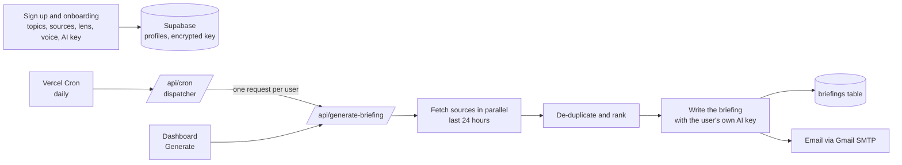

<div align="center">


# Neo

**Personal market intelligence.**<br/>
Everything you follow, in one morning briefing about you.

[**Live app**](https://neo-flax-theta.vercel.app) · [How it works](#how-it-works) · [Run it yourself](#run-it-yourself) · [For companies](#for-companies)

   

</div>

---

## The problem

You follow a dozen publications, a few newsletters, some podcasts and a handful of people. Every morning that is forty tabs, and almost none of it is written for you. News is written for everyone, so it isn't about anyone.

## What Neo does

Neo combines your news, newsletters, podcasts and feeds into **one briefing**, then writes it **through your own lens**: your role, your market and your goals. You tell it who you are once. Every story is explained in terms of your situation, with a source and a timestamp on each one.

The same story, for two different readers:

> **Seed investor, New York**
> Fee cuts squeeze every fintech that sells payments to startups. Check which portfolio companies earn from the spread, and how much of their revenue depends on it.
>
> **B2B founder, Lagos**
> Cheaper rails help you, and your customers will notice the same news. Revisit your pricing before they ask, and see whether a local provider will match the offer.

## Inside a briefing

Every briefing follows the same shape, so it can be read in about five minutes:

1. **A greeting that references your world**, not a generic good morning.
2. **Stories grouped under your topics.** Each one starts with its source and age (for example *Axios · 3h ago*) and is marked as an article, a podcast episode or a video.
3. **Three beats per story.** What happened in one sentence, why it matters to *you* in two or three, and what to do or watch for in one.
4. **Today's signal.** One closing paragraph that ties the day's stories together.

Neo is told to analyse rather than summarise, to skip anything that isn't relevant to your lens, and to never write about a story without naming where it came from.

## Who it's for

- **Investors and operators** who need to know what moved in their sector before the first meeting.
- **Founders** tracking competitors, regulation and funding in their market.
- **Students and early-career people** building market knowledge, with an expertise setting that explains terms instead of assuming them.
- **Anyone with too many tabs** who would rather read one page that already knows what they care about.

## For companies

Neo is built for one person today, but the problem is the same inside a company: everyone follows the same market through different tabs, and nobody has time to turn it into what it means for *their* job.

The same engine works for a team:

- **A shared watchlist.** One set of publications, competitors, regulators, podcasts and communities that matter to the business.
- **A lens per role.** The same morning's news written once for the CEO, once for sales, once for product and once for the investor relations lead, each with its own implications and actions.
- **Delivery where the team works.** Email on a schedule today, and the same briefing can go to Slack or a shared dashboard.
- **Private context.** A system can also read what only your company has, such as internal updates, CRM notes or a customer list, so the briefing reflects your position and not only the public news.
- **Your own AI account.** Briefings run on the company's own API key, so cost and data handling sit with you.

What is in this repository is the individual product. Company systems are built to order on top of it. If you'd like one for your team, [email me](mailto:jeettotla@gmail.com?subject=Market%20intelligence%20system%20for%20our%20company) with the sector, the competitors and sources you track, and who should receive it.

## How Neo chooses what you read

1. **Collect.** Your publications, Substack newsletters, podcasts, YouTube channels, Reddit communities and X accounts, plus Google News, GDELT and Hacker News for your topics, all fetched in parallel for the last 24 hours.
2. **De-duplicate.** Near-identical headlines are merged, preferring the version from a publication you chose. Anything that was in your previous briefing is removed.
3. **Rank.** Stories from your own publications score highest, then matches to your topics, strong community signal and freshness.
4. **Select.** At least one story per topic you follow, then the best of the rest up to the limit for the depth you picked.
5. **Write.** The selected stories, your lens and your voice go to the AI model you connected, which writes the briefing. Your briefing is saved to your history and emailed to you.

## Features

- **One briefing from many sources.** Publications, Substack newsletters, podcasts, YouTube channels, Reddit, Hacker News, Google News, GDELT and mentions of X accounts you track.
- **A personal lens.** Your role, market and goals decide what is kept, what is dropped and why each story matters to you.
- **Always fresh.** Only the last 24 hours, de-duplicated, and never a story you already saw in your previous briefing.
- **Three depths.** Scan (8 stories, two sentences each), Read (12 stories with context), Deep (5 stories, full analysis).
- **Three voices.** Analyst, Journalist or Advisor, plus an expertise setting that controls how much jargon is explained.
- **Every story attributed.** Each item names its source and how long ago it was published.
- **Delivered every morning.** By email, and on a dashboard where you can generate on demand, browse history and change settings.
- **Bring your own AI key.** Google Gemini (free tier), OpenAI or Anthropic. Neo never pays for your briefings and never sees your key again after it is saved.

## How it works



The dashboard and the cron use the same endpoint, so a manual briefing and a scheduled one take the same path. The cron only dispatches work: each user is generated in its own serverless invocation, so no single run has to finish everyone inside Vercel's 60-second limit.

## Bring your own key

| Provider | Cost | Get a key |
| --- | --- | --- |
| **Google Gemini** | Free tier (daily limits, no card needed) | [aistudio.google.com/apikey](https://aistudio.google.com/apikey) |
| **OpenAI** | Paid, prepaid credit | [platform.openai.com/api-keys](https://platform.openai.com/api-keys) |
| **Anthropic** | Paid, prepaid credit | [console.anthropic.com/settings/keys](https://console.anthropic.com/settings/keys) |

Keys are checked against the provider when you save them (a free model-list call), then encrypted with AES-256-GCM and stored in a table with row level security and no public policies, so only the server can read it. The browser only ever learns the provider and the last four characters.

Default models are `gemini-2.5-flash`, `gpt-5-mini` and `claude-sonnet-4-6`. Override them with `GEMINI_MODEL`, `OPENAI_MODEL` or `ANTHROPIC_MODEL` if a provider renames or retires one.

## Tech stack

| Layer | Choice |
| --- | --- |
| App | Next.js 14 (App Router), TypeScript |
| Styling | Tailwind CSS with hand-written design tokens |
| Auth and database | Supabase (Postgres, Auth, row level security) |
| AI | Gemini, OpenAI or Anthropic over plain `fetch`, with each user's own key |
| Email | Gmail SMTP through Nodemailer |
| Hosting and scheduling | Vercel (the Hobby plan is enough) |
| Package manager | Bun |

Everything runs on free tiers. The only cost is each user's own AI usage.

## Run it yourself

### 1. Clone and install

```bash
git clone https://github.com/jeet-totla/neo.git
cd neo
bun install
```

### 2. Create the database

Create a project at [supabase.com](https://supabase.com), open the SQL editor and run [`supabase/schema.sql`](supabase/schema.sql). It is safe to re-run. It creates `profiles`, `briefings` and `user_secrets` with row level security, and upgrades older tables in place.

In **Authentication → URL Configuration**, set the Site URL to your deployed address and add `https://your-domain/**` and `http://localhost:3000/**` to the redirect URLs.

### 3. Configure environment variables

```bash
cp .env.example .env.local
```

| Variable | Where to get it |
| --- | --- |
| `NEXT_PUBLIC_SUPABASE_URL`, `NEXT_PUBLIC_SUPABASE_ANON_KEY` | Supabase → Project Settings → API |
| `SUPABASE_SERVICE_ROLE_KEY` | Same page. Server only, never exposed to the browser |
| `ENCRYPTION_KEY` | Any long random string: `openssl rand -hex 32`. If it changes, saved user keys can no longer be read |
| `GMAIL_USER`, `GMAIL_APP_PASSWORD` | A Gmail account with 2-step verification, then Google Account → Security → App passwords |
| `CRON_SECRET` | Any random string: `openssl rand -hex 32` |
| `NEWSAPI_KEY` | Optional. Extra coverage from [newsapi.org](https://newsapi.org) |
| `GEMINI_MODEL`, `OPENAI_MODEL`, `ANTHROPIC_MODEL` | Optional model overrides |

### 4. Run it

```bash
bun run dev
```

Open http://localhost:3000, create an account, finish onboarding and generate your first briefing from the dashboard.

### 5. Deploy

1. Push to GitHub and import the repository in [Vercel](https://vercel.com).
2. Add the same environment variables under **Project Settings → Environment Variables**.
3. Deploy. Vercel reads [`vercel.json`](vercel.json) and runs the daily cron, sending `CRON_SECRET` as a bearer token.

Environment variable changes only apply to new deployments, so redeploy after changing one. Run `bun run build` locally before pushing.

## Project structure

```
app/
  page.tsx                  Landing page
  login, signup, forgot-password, reset-password
  onboarding/               Topics, sources, lens, voice and AI key
  dashboard/                Today, history and settings
  privacy, terms
  api/
    generate-briefing/      Generates, saves and emails one briefing
    cron/                   Daily dispatcher
    api-key/                Verifies, encrypts and stores a user's AI key
  auth/                     Supabase callback and sign out
components/
  landing/                  Hero animation, lens demo, logo tiles, scroll effects
  ApiKeyField.tsx           Provider picker and key input
lib/
  briefing-engine.ts        Source fetching, ranking and the prompt
  providers.ts              Gemini, OpenAI and Anthropic: verify and complete
  user-key.ts, crypto.ts    Encrypted key storage
  mailer.ts                 Gmail SMTP and the email template
  catalog.ts                Topics, publications and podcasts people can pick
  supabase/                 Browser, server, admin and middleware clients
supabase/schema.sql         Schema and row level security
```

## Limits and design decisions

- **Cost control.** Each account can generate five briefings per rolling 24 hours. The cron skips anyone who already received one in the last 18 hours.
- **Scale.** One cron run starts up to 25 briefings, which keeps a run inside Vercel's time limit and Gmail's daily sending cap (about 500 messages). Past a few hundred users, move email to a transactional provider and raise the batch size.
- **One delivery time.** The Hobby plan allows one cron per day, so every briefing goes out at 11:00 UTC. Per-user times need a paid plan or an external scheduler.
- **Newsletters.** Substack is read through its feed. Other newsletters are covered through the publication's site when it has one.
- **X accounts.** Mentions are found through news search. Neo does not use the X API.
- **Freshness over volume.** Only the last 24 hours, minus anything in your previous briefing.

## Design

Near-black surfaces, warm off-white type and one ember accent. A display serif for large headlines only, a sans for the interface and a monospace for datelines. Line icons at one size, a 4px spacing grid, and light glass only where real content sits behind it. The logo is a sunrise over a horizon: a morning briefing. Principles adapted from [unslop](https://github.com/heydamir/unslop) by Damir Sokolovsky (CC BY 4.0).
